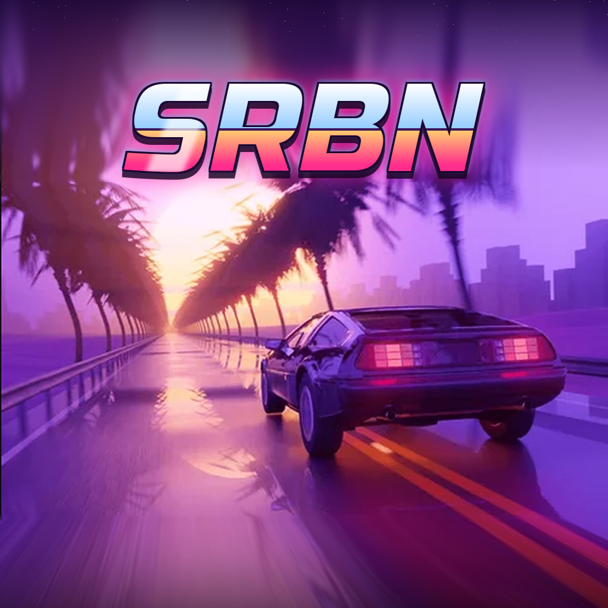

  

<h1 align="center">Super Road Blaster Next · ロードブラスター</h1>

  Port para Android del juego homebrew <b>Super Road Blaster</b> (SNES + MSU-1),
  readaptado y mejorado como proyecto personal y <b>sin ánimo de lucro</b>.

---

## Qué es

**Super Road Blaster Next** lleva a Android, en una sola APK con su propio launcher, el
*Super Road Blaster* original para Super Nintendo: la conversión del clásico de LaserDisc
*Road Blaster* que funciona en una SNES real gracias al chip **MSU-1**, con vídeo y sonido
en streaming.

Este proyecto **no sustituye ni modifica la obra original**. La toma como base y añade una
capa de adaptación pensada para consolas portátiles Android con mando, como la AYN Odin 2
Portal, y para móviles con pantalla táctil:

- **Launcher propio** con estética synthwave: intro animada, menús con mando o táctiles,
  carga del juego desde un .zip y sonidos de menú creados para el port.
- **Restauración HD** de la imagen: limpieza del ruido del códec de vídeo MSU-1, reescalado
  con reconstrucción de bordes (AMD FSR 1.0 EASU) y nitidez adaptativa. También hay modo
  CRT y otros filtros.
- **Pack HD opcional**: un add-on que se instala aparte y cambia el vídeo por la película en
  alta definición, sincronizada con el juego y con el salpicadero animado (puntos, vidas y
  palanca que sigue al acelerador y al freno). Se crea con `tools/hdpack` a partir de tu
  propia copia; el repositorio no incluye ningún vídeo.
- **Audio MSU-1 Enhanced**: el audio original se procesa en tiempo real: volumen igualado
  entre escenas, ecualización ligera y limitador de picos, con la sincronía exacta con el vídeo.
- **Director's Mode**: ver la película completa sin tocar nada, QTE automático o asistido,
  invencibilidad, cámara lenta sin cambio de tono y selector de escenas.
- **Controles táctiles flotantes** y semitransparentes para jugar en móviles sin mando.
- **Partida continua**: el juego recuerda dónde lo dejaste.

## Sin ánimo de lucro

Es un proyecto hecho por afición, **gratuito y sin ningún fin comercial**. No se vende, no
lleva publicidad y no se distribuye ninguna APK compilada.

Este repositorio **no contiene** la ROM, el archivo de datos `.msu`, las pistas de audio
`.pcm` ni ninguna imagen, vídeo o sonido del juego o del anime. La app solo funciona con
la copia que cargue cada usuario. Todo el mérito del juego es de sus autores (ver créditos).

## Créditos

### La obra original
- ***Road Blaster*** (ロードブラスター, 1985): juego de LaserDisc para recreativa de
  **Data East**, con animación de **Toei Animation** supervisada por **Yoshinobu Inano**.
  Fuera de Japón se conoció también como *Road Avenger* (Mega-CD).
  Todos los derechos de la animación, la música y la marca pertenecen a sus titulares.
- ***Super Road Blaster*** (2012): conversión homebrew para Super Nintendo con MSU-1, obra de
  **snesdev0815** (firmada en el juego como «ported by d4s in 2012»). Programada íntegramente
  en ensamblador 65816, con código fuente publicado bajo licencia MIT en
  [github.com/snesdev0815/SNES-SuperRoadBlaster](https://github.com/snesdev0815/SNES-SuperRoadBlaster).
- **MSU-1**: el chip de expansión para streaming de datos, vídeo y audio en SNES, creado por
  **byuu (Near)**.

### Software usado en este port
- **Snes9x**: emulador de Super Nintendo, con soporte MSU-1 (licencia Snes9x, uso no comercial).
- **AMD FidelityFX Super Resolution 1.0 (EASU)**: AMD (MIT), en la versión GLSL de libretro slang-shaders.
- **Sonic**: Bill Cox (Apache 2.0), para estirar el audio en cámara lenta sin cambiar el tono.
- **dr_flac**: David Reid (dominio público / MIT-0).
- Tipografías **Chakra Petch, Russo One, Share Tech Mono y Kaushan Script** (SIL Open Font License).

### Port para Android
Launcher, Director's Mode, restauración HD, MSU-1 Enhanced, controles táctiles e icono SRBN:
**Mckeijas**.

## Compilar

Las instrucciones completas están en [LEEME.md](LEEME.md). En resumen:

1. Abre la carpeta `android` con Android Studio.
2. *Build ▸ Build APK(s)* con la variante **release**.
3. Instala la APK y, desde su menú, usa **Cargar juego (.zip)** con tu copia de Super Road
   Blaster (`SuperRoadBlaster.sfc`, `.msu` y `-0.pcm` … `-121.pcm`).

La APK **no lleva el juego**. Los puntos de inicio de cada escena, las miniaturas y el audio
Enhanced los genera la app en tu dispositivo a partir de tu copia.

Requisitos: Android 11 o superior, ARM64 y OpenGL ES 3.0.

## Aviso legal

Proyecto de fans, sin relación con Data East, Toei Animation ni sus sucesores, ni con
Nintendo. *Road Blaster* y los nombres relacionados son marcas de sus respectivos
propietarios. Si eres titular de algún derecho y quieres que se retire algún contenido,
abre una *issue* y se atenderá enseguida.
